  Application and infrastructure security, learned hands-on: write the vulnerable version, exploit it, fix it, 
  then prove the same attack no longer works. Everything I build for that is open source and runs locally.

<table>
  <tr>
    <td width="50%" valign="top">
      
      
Twelve labs from SQL injection and XSS to JWT forgery and race conditions. Each runs the vulnerable code and
      its fix side by side, shows the diff, and checks on the server that your attack lands on one and fails on the other.

      
<a href="https://github.com/TroubieD3v/WebSec-Lab"><b>Repository</b></a> &nbsp;·&nbsp;
      <a href="https://github.com/TroubieD3v/WebSec-Lab#quick-start-docker">Quick start</a>

    </td>
    <td width="50%" valign="top">
      
      
Import OpenAPI or Postman, add test accounts, say who owns which objects. AuthScope compares real responses with
      your policy, so <code>200 []</code> is not a finding, and every violation comes with both requests and a curl to reproduce it.

      
<a href="https://github.com/TroubieD3v/AuthScope"><b>Repository</b></a> &nbsp;·&nbsp;
      <a href="https://github.com/TroubieD3v/AuthScope#quick-start-docker">Quick start</a>

    </td>
  </tr>
  <tr>
    <td width="50%" valign="top">
      
      
Reads Docker Compose, Kubernetes and Terraform plans offline and builds a graph of who can reach what. It shows how
      an exposed pod, a mounted token and a broad role add up to a path to your secrets, traces every step to a line of
      config, and simulates which fix breaks the most chains before you touch a file.

      
<a href="https://github.com/TroubieD3v/CloudGraph"><b>Repository</b></a> &nbsp;·&nbsp;
      <a href="https://github.com/TroubieD3v/CloudGraph#quick-start-docker">Quick start</a>

    </td>
    <td width="50%" valign="top">
      
      
Tests the whole agent, not just the model: which tools it calls, which data it touches, whose instruction it
      follows. It replays prompt injection, memory poisoning and data leaks against sandbox agents with mock tools,
      records the full trace, and shows the same attack recorded in Monitor mode and blocked in Enforce mode.

      
<a href="https://github.com/TroubieD3v/AgentShield"><b>Repository</b></a> &nbsp;·&nbsp;
      <a href="https://github.com/TroubieD3v/AgentShield#quick-start-docker">Quick start</a>

    </td>
  </tr>
  <tr>
    <td width="50%" valign="top">
      
      
Reads lockfiles and SBOMs without ever running them, builds the real dependency graph and matches every resolved
      package against OSV advisories. Each finding shows the path that brought the package in and the lockfile line behind
      every hop. A package that was not evaluated is never reported as clean, and a what-if mode compares an upgrade
      before you touch a file.

      
<a href="https://github.com/TroubieD3v/SupplyChainRadar"><b>Repository</b></a> &nbsp;·&nbsp;
      <a href="https://github.com/TroubieD3v/SupplyChainRadar#60-second-quickstart">Quick start</a> &nbsp;·&nbsp;
      <a href="https://github.com/TroubieD3v/SupplyChainRadar/releases/tag/v1.0.0">v1.0.0</a>

    </td>
    <td width="50%" valign="top">
      
      
Turns "tenant A must not see tenant B" into real SQL run as each role inside a throwaway PostgreSQL, and records
      what the database actually did: which gate stopped it, which policies applied, and why. Anything it cannot prove
      stays inconclusive, never "safe". A live database is only ever read, a what-if lab replays a policy change before you ship it, and a generated
      schema of 1 000 tables and 10 000 policies runs end to end in under 30 seconds.

      
<a href="https://github.com/TroubieD3v/RLS-Sentinel"><b>Repository</b></a> &nbsp;·&nbsp;
      <a href="https://github.com/TroubieD3v/RLS-Sentinel#quick-start">Quick start</a>

    </td>
  </tr>
</table>

<h4 align="center">One idea, six layers</h4>

  <b>Code</b>: in WebSec-Lab you write the bug, exploit it and watch the fix refuse the same request. 
  <b>API</b>: AuthScope finds the same class of bugs in a running service, using your access policy as the oracle. 
  <b>Infrastructure</b>: CloudGraph shows how the platform around the service turns one bug into a path to the crown jewels, and which change cuts it. 
  <b>AI agents</b>: AgentShield checks what an agent with tools and memory actually does when untrusted text tells it to misbehave. 
  <b>Supply chain</b>: SupplyChain Radar shows how a vulnerable dependency got into the project, through which parent, and which upgrade really removes it. 
  <b>Database</b>: RLS Sentinel tests whether PostgreSQL row-level security keeps every tenant in its own rows, role by role and command by command.

  All six report evidence rather than guesses, separate "proven" from "possible", and ship a vulnerable and a
  hardened version so the tests can show both.

  
<b>See them in action</b>

   
  
<b>WebSec-Lab</b>: Alice reads Bob's booking in the vulnerable mode; in the fixed mode the same request is refused.

  
  
<b>AuthScope</b>: a run against the demo API, the permission matrix, and the evidence for one finding.

  
  
<b>CloudGraph</b>: attack paths in an insecure cluster, one highlighted in the graph, a what-if fix that removes four, and a diff against the hardened version.

  
  
<b>AgentShield</b>: one prompt injection recorded in Monitor mode and blocked in Enforce mode, then the agent trace and a before/after comparison.

  
  
<b>SupplyChain Radar</b>: every path from the app to a vulnerable shared dependency highlighted in the graph, then the finding with its evidence and the upgrade that fixes it. Demo data is synthetic and labelled as such.

  
  
  
<b>RLS Sentinel</b>: the vulnerable fixture finds 8 cross-tenant leaks, the evidence for one shows which gate let it through, a what-if fix removes two in a sandbox without regressions, and the secure variant finds none. All data is synthetic.

  

<h3 align="center">Toolbox</h3>

  
  
  
  
  
  
   
  
  
  
  
  
  
  
  

<h3 align="center">Studying now</h3>

  Web pentesting with the <a href="https://owasp.org/www-project-web-security-testing-guide/">OWASP Web Security Testing Guide</a> 
  Access control and authentication flaws in APIs (<a href="https://owasp.org/API-Security/editions/2023/en/0x11-t10/">OWASP API Security Top 10:2023</a>) 
  Kubernetes and cloud attack paths: RBAC, NetworkPolicy, IAM (<a href="https://kubernetes.io/docs/concepts/security/rbac-good-practices/">RBAC good practices</a>) 
  Security of LLM apps and AI agents (<a href="https://genai.owasp.org/">OWASP GenAI Security Project</a>: LLM and Agentic Top 10) 
  Fixes that hold, and tests that prove they do

